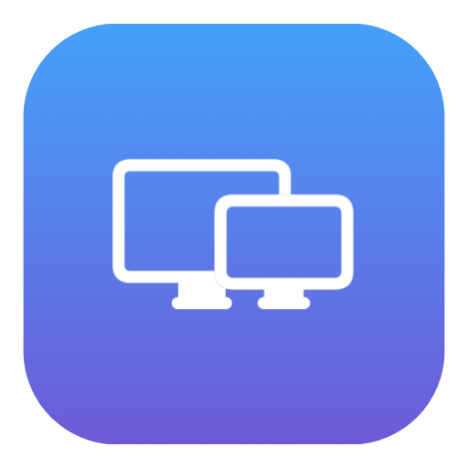

# Display Menu for macOS

A small, free, open-source-style menu bar utility for macOS Sonoma on Intel iMac. It relies on the **displayplacer** tool, installed with either **MacPorts** or **Homebrew**.

## Features
- Menu bar icon, no Dock icon or regular window.
- Lists all monitors detected by `displayplacer list`.
- Labels external displays in bold and shows an ON/OFF switch (blue = ON).
- Flip the switch of an external display to turn it on/off.
- Built-in display is protected and cannot be toggled.
- Refresh item to rescan devices.
- Installs a per-user LaunchAgent to start on future logins.

## What's new in v1.3.2
- External displays are now listed by their **product name** (e.g. "LG HDR 4K") instead of the generic type. The name is remembered, so a switched-off display keeps it.

## What's new in v1.3.1
- `displayplacer` can be installed with **MacPorts or Homebrew**. The app and `install.sh` look in `/opt/local/bin`, `/usr/local/bin` and `/opt/homebrew/bin`.

## What's new in v1.3
- **No more spinning beach ball** when turning a display off/on or changing resolution. `displayplacer` changes now run in the background, so the menu bar app stays responsive while macOS reconfigures the display (which can still take a few seconds). During the change the menu bar icon is dimmed, and the result (or any error) is shown when it finishes.
- **Launch at Login** checkbox in the menu (see below).
- ON/OFF switch is drawn in blue when ON (the system switch shows grey inside menus), and the display name is no longer truncated.

## What's new in v1.2
Resolution submenu and brightness sliders (see below).

## What's new in v1.1
- Fixes `could not find res:0x0 scaling:off` when turning a display back on.
- Before a display is turned off, its working configuration (resolution, refresh rate, color depth, scaling, origin, rotation) is saved. Configurations are also refreshed whenever an enabled external display is seen, and stored in the app's preferences, so they survive restarts.
- Turning a display on restores that saved configuration instead of sending only `enabled:true`. `res:0x0` or any invalid resolution is never sent; if no valid saved configuration exists you get an error message instead.
- The current state is re-read before every action; if the display is already in the requested state, no command runs.
- The menu is refreshed after every operation, and `displayplacer` errors are shown in an alert.
- Works with any number of external displays; nothing is hardcoded.

## Resolution menu (v1.2)
Each enabled display, including the built-in one, has a **Resolution** submenu listing its available modes (8-bit colour, best refresh rate per resolution, `HiDPI` marks scaled modes). The current mode is checked. Picking the already-active mode does nothing. The built-in display can change resolution but still cannot be turned off.

## Brightness sliders (v1.2)
Each enabled display with a working brightness control gets a slider under its name.
- **External displays** use DDC/CI over I2C (no extra tools). Displays that do not answer DDC simply show no slider.
- **Built-in display** uses Apple's private `DisplayServices` framework, loaded at runtime. If a future macOS removes it, only that slider disappears.
- The minimum is 5% so the screen cannot be set fully black.

## Launch at Login (v1.3)
The menu has a **Launch at Login** checkbox. It adds or removes the per-user LaunchAgent (`~/Library/LaunchAgents/com.local.displaymenu.plist`) that `install.sh` creates, so it takes effect from the next login.

## Requirements
- macOS 13 or later (tested conceptually for Sonoma; not tested on a Mac in this environment)
- Apple Command Line Tools: `xcode-select --install`
- `displayplacer`, installed with one of:
  - MacPorts: `sudo port install displayplacer` (`/opt/local/bin`, checked first)
  - Homebrew: `brew tap jakehilborn/jakehilborn && brew install displayplacer` (`/usr/local/bin` or `/opt/homebrew/bin`)

## Installation
1. Unzip, open Terminal, and `cd` into the extracted `DisplayMenuMac` folder.
2. Run `bash install.sh`.
3. Find the display icon on the top menu bar.
4. Flip the switch on an **External** line to toggle its state.

For additional diagnostics run `displayplacer list` in Terminal.

## Caveats
- Some external displays need a cable reconnect before they can be enabled again.
- `displayplacer` can change display identifiers; refresh after reconnection.
- An external display disconnected at the hardware level cannot be turned on via software.
- The app is compiled locally, not notarized/distributed as a prebuilt Mac binary.
- Display detection and control depend on `displayplacer` and the macOS graphics driver.

## Uninstall
Run `bash uninstall.sh` from this folder.
